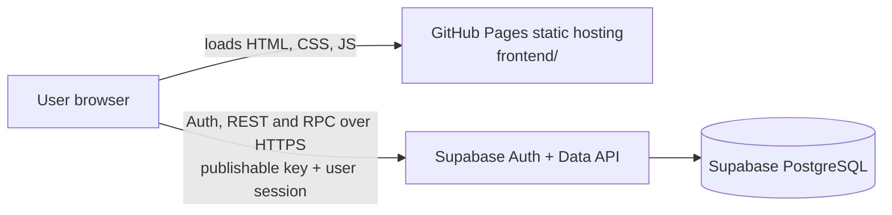

# FinTrack deployment and verification

## Architecture

FinTrack is a static browser application. It has no backend server or Render service in this repository. The browser uses Supabase Auth and the Supabase JavaScript client to call the hosted project's Data API and PostgreSQL functions directly. The repository's GitHub Actions workflow publishes `frontend/` to GitHub Pages.



There is no Render backend in the current design. Do not create a Render web service for this source tree unless a server component is deliberately added in a separate architecture change. No backend build command, start command, port, health check, or Render environment variables currently exist.

## Repository structure

- `frontend/`: HTML, CSS, JavaScript, Supabase browser config and a finance logic test.
- `database/fintrack_schema.sql`: SQL schema snapshot, functions, triggers, grants, and table definitions.
- `database/migrations/`: SQL changes for friend email search and transaction comments.
- `supabase/migrations/`: later security policy and grant changes.
- `supabase/config.toml`: local Supabase CLI configuration template.
- `.github/workflows/deploy-frontend.yml`: GitHub Pages deployment workflow.
- `package.json` and `package-lock.json`: Supabase CLI development dependency and lockfile.

## GitHub source repository

Commit the frontend sources, SQL snapshot and reviewed migrations, Supabase CLI config, documentation, workflow, `.gitignore`, and npm manifests/lockfile. The checked-in workflow deploys only `frontend/`.

Do not commit actual `.env` files, credentials, local dependencies, generated build directories, logs, or temporary files. The browser Supabase publishable key in `frontend/supabase-config.js` is intentionally public; it is not a secret and must be protected by correct database grants and Row Level Security. Never put a Supabase secret or `service_role` key in frontend code.

The current workspace does not contain a usable Git repository: `.git` has no Git metadata and Git commands report that this is not a repository. Therefore tracked/untracked status and historical secret exposure could not be audited here. Initialize/restore the intended Git checkout before committing or assessing repository history. No `.env` file was found in the project tree at audit time.

## Frontend deployment (GitHub Pages)

1. Push the repository's `main` branch to GitHub.
2. In repository Settings → Pages, select GitHub Actions as the deployment source.
3. The workflow builds no bundle; it uploads `frontend/` as a static artifact and deploys it.
4. Set the Supabase Auth Site URL to the published Pages URL and allow that origin's redirect URL (the current frontend README documents the configured URL).
5. Verify the published landing page, sign-in, and authenticated data loading with a test account.

The workflow uses maintained GitHub Actions major versions, but does not pin actions to immutable commit SHAs. Review and update action versions as part of routine supply-chain maintenance.

## Render

No Render service is applicable to the current application. There is no server directory, server dependency manifest, process entrypoint, health endpoint, or backend API. The browser talks directly to Supabase. A separate backend should only be added if there is a product requirement that cannot be safely served by Supabase Auth, RLS, and RPCs.

## Supabase configuration

The frontend currently contains the Supabase project URL and browser-safe publishable key in `frontend/supabase-config.js`. These are browser-visible by design. There are no environment variable references in the application and no `.env.example` is needed. Do not replace the existing project URL or key as part of deployment setup.

Supabase Auth handles email/password signup and sign-in. Authenticated browser requests perform table reads/writes through PostgREST and call PostgreSQL RPCs for operations including transaction save, group creation, friend requests, and settlements. The settlement feature records a payment; it does not transfer funds. The Settings identity-provider controls are demo toggles.

SQL source is split between `database/fintrack_schema.sql`, `database/migrations/`, and `supabase/migrations/`. The schema snapshot enables RLS on all 11 application tables and defines owner/member-scoped policies. A read-only probe confirmed the live project still permits anonymous execution of `is_group_member`; the probe used fabricated UUIDs and suppressed its result. Source review also found `anon` table, sequence, and function grants; a friendship insert policy that allowed direct accepted links; a group-member insert policy that did not require an accepted friendship; and direct settlement inserts that bypassed the validated RPC. The combined migration `supabase/migrations/20261117130000_public_demo_security.sql` removes anonymous privileges and default grants, limits friendship/group-member inserts to the intended flows, restricts direct friendship updates and settlement inserts, and keeps settlements on the validated RPC. It consolidates the earlier membership and settlement policy scripts, so apply this one file in the Supabase SQL editor instead of running those older scripts separately. It has not been applied to the hosted project. The Supabase CLI could not query live policies/grants or migration history because no CLI access token is configured.

After applying the combined SQL in Supabase SQL Editor, verify the key grants and RLS flags with:

```sql
select
  has_table_privilege('anon', 'public.transactions', 'select') as anon_can_read_transactions,
  has_function_privilege('anon', 'public.is_group_member(uuid,uuid)', 'execute') as anon_can_call_group_helper,
  has_table_privilege('authenticated', 'public.settlements', 'insert') as authenticated_can_insert_settlements;

select relname, relrowsecurity
from pg_class
where oid in (
  'public.transactions'::regclass,
  'public.users'::regclass,
  'public.settlements'::regclass,
  'public.split_group_members'::regclass
);
```

The first query should return `false` for all three privilege checks; the second should show `relrowsecurity = true` for each table.

## Local development

From `frontend/`, serve the files over HTTP, for example:

```sh
python3 -m http.server 5500
```

Open `http://localhost:5500`. Do not open `index.html` with a `file://` URL. For email confirmation, allow the local origin in Supabase Auth URL Configuration. The current code uses the configured hosted Supabase project, so authenticated actions reach that project's data.

## Checks

Run the existing finance logic test with:

```sh
node --test frontend/tests/finance.test.js
```

There is no frontend build script or backend test suite. Syntax checks can be run with `node --check frontend/app.js`, `node --check frontend/finance.js`, and `node --check frontend/supabase-auth.js`. A local HTTP server only verifies static delivery; it does not prove authentication, database access, or production deployment.

Database verification can use read-only queries for connectivity, table presence, constraints, and policies. Do not test writes against real user data. Authenticated feature testing should use a designated test account and isolated test records only; the owner will perform those checks.

## Environment variables

- Frontend: none; Supabase URL and publishable key are currently source-configured.
- Render: none; no Render backend exists.
- Supabase: no project secrets are required in this repository. Hosted project credentials/settings are managed in Supabase.

## Production checklist

- [ ] Restore the intended Git repository and inspect its full history for previously committed secrets.
- [ ] Confirm GitHub Pages is enabled and the Actions deployment succeeds.
- [ ] Confirm Supabase Auth site/redirect URLs match the final Pages origin.
- [ ] Review and apply `supabase/migrations/20261117130000_public_demo_security.sql` to the intended Supabase project.
- [ ] Verify live RLS policies, grants, RPC execute permissions, and migration history in Supabase.
- [ ] Sign in with a designated test account and verify read/write flows using test-only records.
- [ ] Confirm no Supabase secret or `service_role` key is included in frontend assets.
- [ ] Smoke-test the deployed site over HTTPS and inspect browser console/network errors.

## Known issues and unresolved verification

- No Render backend exists; deploying one is not applicable without an architecture change.
- The workspace has no usable Git metadata, preventing a tracked file and historical secret audit.
- Hosted Supabase connectivity and table existence were verified using zero-row read-only REST requests. An anonymous helper RPC was also confirmed reachable. The source SQL has RLS policies and relational constraints, but live policies, constraints, all RPC grants, and migration state have not been verified because Supabase CLI authentication is missing.
- The schema snapshot and migration history are split across directories; frontend README paths were corrected, but database migration parity still needs an operator review against the hosted project.
- External identity-provider settings are demo-only.
